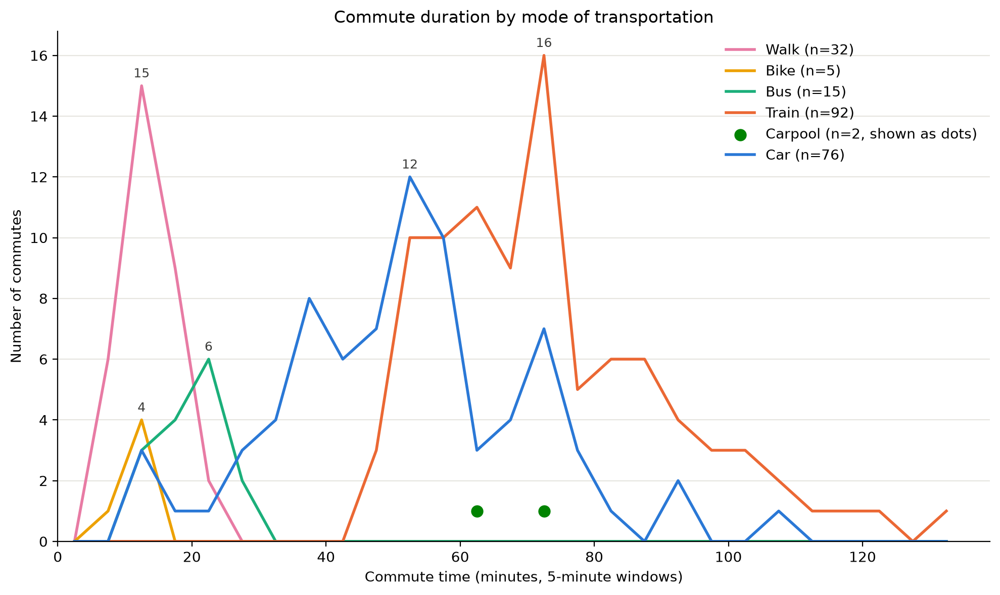
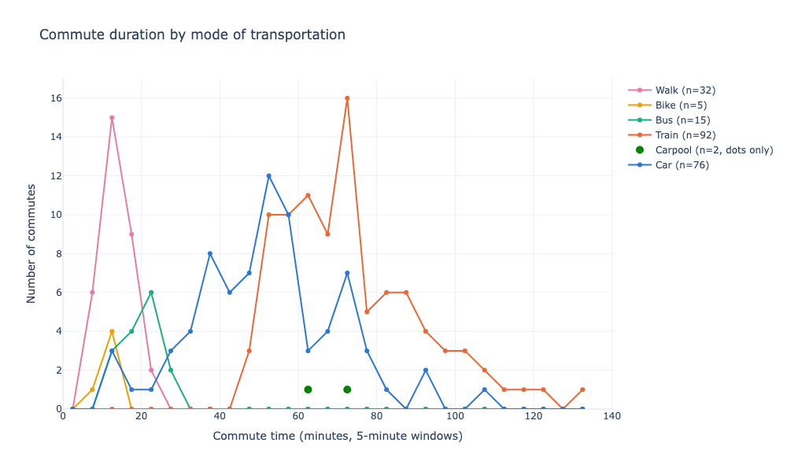
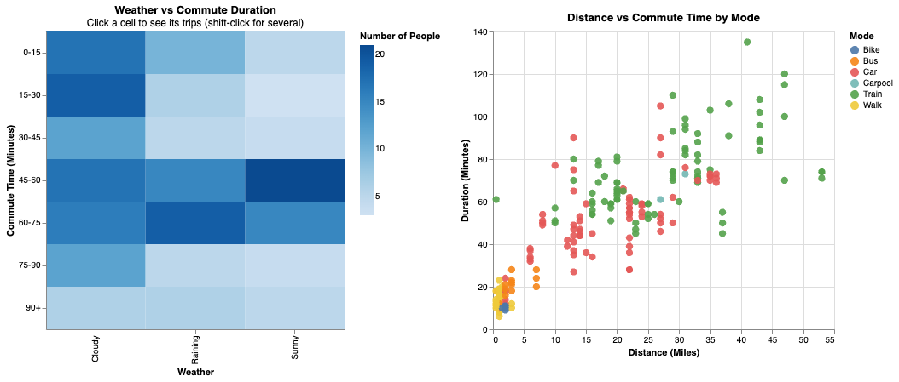

## Task 1 : Revisiting Our Data and Questions

During assignment 1, we inspected our dataset more carefully and identified several problems that would limit our analysis. We decided it may be too late to pivot during Assignment 1, so we made changes now, as part of our Assignment 2. The original Google Form collected commute duration and distance as bucketed ranges (e.g. “45-60 minutes”, “25-30 miles”) and starting location as free text. This caused the following issues:

Bucketed values blocked scatterplots and true averages. We couldn’t analyze continuous relationships
Free-text locations were inconsistent. While normally this could be fixed with data cleaning, we figured it was an issue on our side with data collection being unclear, since we had vague entries like “suburb” and “city-Chicago” rather than specific area names.

To address these problems, we rebuilt the Google Form midway through collection. The new form collects one day per submission, uses exact numeric values for duration and distance, uses a fixed dropdown for starting location, and eliminates the N/A confusion by only asking about days the respondent actually commuted. We are continuing to collect data with the new form through mid-October, and compiled it to ‘data/raw/a2_commute_data.csv’

**Guiding Questions for Assignment 2:**

For this assignment, our goal is to understand the shape and limitations of our newly cleaned dataset while building working visualizations and before building our final visualizations. We will use the following data-exploration questions to guide our work in Task 3:

1. What does the majority of people use to commute?
2. What time windows have the highest volume of commuters?
3. Are there specific days where commute times spike?
4. Which data points (weather, distance, transport mode) show the most interaction with each other?
5. How many observations did we lose or gain by switching to the new form format?

These guiding questions will help us determine which of our domain questions from Assignment 1 are actually supported by the data before we commit to our final visual designs.

## Task 2 : Preparing the data

All data cleaning code is located in the `datacleaning.py` file. This file reads in the raw google form data from `data/raw/` and writes out the cleaned dataset to `data/processed/commutes_clean.csv`. The raw files are not edited by hand, so running the script should always reproduce the same output.

**Main Transformations Done:**

- **Renamed Columns**: The long form questions were renamed to short names for us to utilize as variables (e.g. `location`, `duration_minutes`) so they are easier to work with in code and charts.
- **Dropped `timestamp`**: this column only recorded the time of form submission, not when the commute happened, so `date` is used instead.
- **Converted types**: Dates, times, and numbers were stored as text. We converted them to real date, time, and numeric types so they can be sorted, compared, and plotted on continuous axes.
- **Standardized locations.** Respondents typed the same place in different ways (e.g. "little italy", "Little Italy, Chicago", "Taylor and Carpenter"). We mapped every variant to one name using a lookup table, `data/lookups/locations.csv`, and added a `location_region` column (Chicago or Suburb) for city vs. suburb comparisons.
- **Standardized mode and weather.** Merged equivalent labels such as "Car" and "Car (alone)", and "Clear" and "Sunny", so each category is counted once.
- **Added derived columns:**
  - `respondent_id`: an anonymous ID (R1, R2, ...) for each entry
  - `is_rainy`: whether it was raining, for weather comparisons
  - `near_uic`: whether the commute started within 5 miles of campus, to separate local commuters from long-distance ones
  - `duration_bucket`: 15-minute ranges matching our Assignment 1 sketches, for grouped charts

**Things to consider in Assignment 3**

Data inconsistencies due to user error, examples include:

- Submitting 12:30AM instead of PM
- Mileage not aligning with the cities they select
- Misclicking mode of transportions
- People estimating their time rather than adding exact time, which creates buckets on accident
- Other forms of user error

## Task 3 : Explore the data

[view](task3.ipynb)

## Task 4 : Implement visualization alternatives

### Commute Duration by Mode of Transportation

This figure aims to answer the two following questions that we had:

- What does the majority of people use to commute?
- What time windows have the highest volume of commuters?

**Attributes used**:

- duration_minutes (quantitative)
- mode_of_transportation (categorical)

**Marks and channels**:

- Marks:
- Lines, one smooth curve per mode of transporation
- Points for modes with too few commutes to draw a curve
- Channels:
- Horizontal position for commute time in minutes
- Vertical position for how common that commute time is within each mode
- Color hue to tell modes apart

**Why did we try this approach**:
This approach was an attempt to reimplement Sketch 4 from assignment 1. In the original sketch, commute times were grouped into 15-minute buckets because the original form only collected ranges. With the new form collecting exact minutes, we replaced the buckets with a smoothed curve for each mode, so the shape of each distribution comes from the real values instead of fixed ranges. Each curve is scaled to its own mode, which keeps the refinement from our sketch: Train and Car do not dominate the chart just because they have more observations.

**What worked and What didn't**:
Some things that worked include: The staircase pattern in the sketch reflext the data accurately and shows us where peak times are for each of the different modes of transportation. Exact minutes being used also displays data that the buckets initially grouped up, allowing for the data to reveal what we didn't ntoice before. Like how car travel can be very unpredictable in comparison to train or walking.

Some things that didn't work include: Biking data only having a couple commutes, all being within the same time frame, so the curve is just a tall narrow spike in the data. Carpool also only has 2 data points, so we can't draw that many conclusions since we don't have much data. Since this is based on density, we don't know the exact counts at each minute interval since we smoothed the graph so we can make accurate comparisons.

**Whether we will keep, modify, combine, or abandon**:
It would be a good idea to modify this graph in the future. It is a strong direction in answering our domain question, but trying a version that displays counts or maybe shows the data in a way that reveals something else may benefit us.

### Weather vs. Commute Duration (Heatmap)

This figure aims to answer the following question:

Does weather affect transportation modes for people who walk or bike to UIC? (And more broadly, how does weather impact commute times?)

**Attributes used:**

weather (categorical)
duration_bucket_str (ordinal)
count of respondents (quantitative)

**Marks and channels:**

Marks: Rectangles (grid cells)
Channels:
Horizontal position for weather condition
Vertical position for commute time bucket
Color intensity (saturation) for the number of people in that weather/time combination (darker = more people)

**Why did we try this approach:**

This approach was an attempt to reimplement our Assignment 1 heatmap sketch using our new, cleaner dataset. By using color intensity as the main channel, we are able to layer three different attributes into a single view without visual clutter. This lets us instantly spot clusters, such as whether rainy commutes heavily group around a specific duration compared to sunny days.

**What worked and What didn't:**

What worked well was the immediate readability of the color gradients. It successfully surfaces patterns that a bar chart might bury in grouped clusters, showing exactly where the "bulk" of commutes happen for each weather condition. What didn't work as well is that a heatmap only shows counts, not averages. We can see that a lot of people commute for 45-60 minutes when it is cloudy, but we can't tell if the weather actually caused that duration or if those people just live far away.

**Whether we will keep, modify, combine, or abandon:**

We will keep this graph and likely combine it with an interactive filter. In Task 5, we linked this heatmap to a scatterplot. This combination is powerful because it allows us to filter the heatmap by specific weather conditions while seeing which modes of transport are driving those long commutes in the scatterplot.

### Distance vs. Commute Time by Mode (Scatterplot)

This figure aims to answer the following questions:
What is the biggest indicator that there will be longer commute times in someone's day?
Does neighborhood/distance predict transportation mode choice?

**Attributes used:**

distance_miles (quantitative)
duration_minutes (quantitative)
mode_of_transportation (categorical)
day_of_week, weather, location_clean (used for hover context)

**Marks and channels:**

Marks: Points (dots)
Channels:
Horizontal position for distance in miles
Vertical position for commute time in minutes
Color hue to distinguish the mode of transportation
Tooltips on hover to reveal the day, weather, and starting location
**Why did we try this approach:**

This was a brand new direction for us, made possible only by switching to our revised data collection form. In Assignment 1, distance and time were bucketed ranges, which blocked us from making a true scatterplot. Now that we have exact numeric values, we can visualize continuous relationships. We wanted to see if there is a direct correlation between how far someone lives and how long it takes them, and whether that relationship changes depending on how they travel.

**What worked and What didn't:**

What worked well is that it clearly shows the strong positive correlation between distance and time. It also beautifully highlights how unpredictable car travel is compared to the train. The car dots are very scattered, meaning two people driving the same distance can have vastly different commute times, whereas the train dots form a much tighter line. What didn't work as well is overplotting. Because many people live 0 to 5 miles away, the dots overlap heavily in the bottom-left corner, making it hard to see exact counts.

**Whether we will keep, modify, combine, or abandon:**

We will definitely keep this graph. For Task 5, we implemented this scatterplot side-by-side with the heatmap and added an interactive filter. It is a very strong analytical tool. If we were to modify it, we might add a slight transparency to the dots (opacity) or jitter them to solve the overplotting issue in the dense areas.

## Total Commutes by Day of the Week (Pie Chart)

This figure aims to answer the following question:
Is there a day when the commute takes longer compared to the rest of the week? (Specifically, looking at attendance volume as a proxy for campus activity).

** Attributes used:**
day_of_week (categorical)
count of respondents (quantitative)

**Marks and channels:**
Marks: Sectors (slices of a pie)
Channels:
Angle (size of the slice) for the number of commutes
Color hue to distinguish the days of the week

**Why did we try this approach:**

We wanted a simple overview visualization to understand the coverage of our dataset. Before diving into complex relationships, we needed to know if our data was evenly distributed across the week. A pie chart is an intuitive way to see the proportion of total commutes that happen on each day.

** What worked and What didn't:**

What worked well is that it immediately shows if our data collection was biased toward certain days (for example, if we accidentally collected way more data on Tuesdays). It serves as a good baseline to remind us that our sample is not perfectly even. What didn't work as well is that a pie chart is limited. It shows us how many people commute on a given day, but it tells us absolutely nothing about how long those commutes take. We cannot use this to answer if a day is "worse" for commuting, only if it is "busier" in our dataset.

**Whether we will keep, modify, combine, or abandon:**

We will likely abandon this graph for our final visualizations. While it was helpful for our own exploratory understanding (Task 3), it does not deeply answer our core domain questions about durations, weather, and modes. If we want to show day-of-week differences in the final design, a bar chart showing average commute time per day would be much more useful and expressive than a pie chart of raw counts.

## Task 5 : Interaction and multiple views

We paired a heatmap with a scatterplot because they answer different levels of the same question: how does weather relate to commute time? The heatmap summarizes how many commutes fall into each combination of weather condition and duration bucket. The scatterplot shows the individual trips behind those counts, plotting distance against duration and coloring by mode of transportation.

The two views are linked by click selection. Clicking a heatmap cell highlights the matching trips in the scatterplot and fades the rest, and shift-clicking selects several cells. This supports a specific task: when a viewer notices a pattern in the summary, such as a cluster of long commutes on rainy days, they can check whether those trips are explained by distance or by mode of transportation. The heatmap is the overview and the scatterplot is details-on-demand, which is why the views belong together rather than being a dashboard of unrelated charts. Hovering over a point also shows exact values (day of week, mode, distance, duration).

We deliberately did not add a weather dropdown. Weather is already encoded on the heatmap’s x-axis, so filtering by it would remove the very comparison the chart is meant to support. We also did not add zooming or panning, since the dataset is small enough that every point is readable in the full view.

## Task 6 : Iterate and refine

In the end, we chose our coordinated scatterplot and heatmap as our strongest direction to refine. The scatterplot shows individual trips (distance vs. commute time, colored by transportation mode), and the heatmap shows an aggregate view (weather vs. commute duration, colored by number of commutes). Together, they address two of our domain questions: what drives longer commutes, and whether weather affects commute time. Through iteration, we moved from a single-question chart, to linked views with a dropdown filter, to an overview-to-detail interaction where each view has a clear role.

### Starting Point: Commute Duration by Mode (Plotly)

Our first version was an interactive Plotly line chart showing how commute time varies by transportation mode. Commute times were grouped into 5-minute windows, and each mode was drawn as its own line showing the number of commutes in each window. Modes with too few commutes to form a meaningful line (Bike and Carpool) were shown as individual dots instead. Hovering over any point shows a pop-up with the transportation mode, the commute time window, and the number of commutes, so exact values are available without labeling every point.

Below is the static png of this version. The interactive version can be viewed by opening `figures/task5_commute_duration_by_mode_plotly.html` in a browser.

### Iteration 1: From a Single Chart to Linked Views (Vega-Lite)

**Problem noticed:** This chart only answers one question: how commute time differs by mode. It cannot show distance or weather, which are central to our domain questions about what causes longer commutes. Because commutes are counted into time windows, individual trips are also hidden. A viewer can see that 16 train commutes took 70-75 minutes, but not how far those people traveled or what the weather was. Raw counts also made Train and Car stand out simply because they had the most observations.

**What we changed:** We pivoted to Vega-Lite (via Altair), which is explicitly designed for coordinated multi-view filtering using selection parameters. We built two linked views: a heatmap of weather against commute-time buckets, and a scatterplot of every individual trip with distance on the x-axis and commute time on the y-axis, colored by transportation mode. A weather dropdown filtered both charts at once.

**Why:** The scatterplot brings back individual trips and adds distance, and the heatmap adds weather, so together they cover the attributes the Plotly chart could not show. Vega-Lite's selection parameters let one control update both views without writing custom linking logic.

[Add the screenshot of the dropdown version here]

### Iteration 2: From Dropdown Filter to Click-to-Explore

**Problem noticed:** The weather dropdown had a technical bug (the "All" option grayed out every point because "All" was not an actual value in the weather column, so the selection matched nothing). More importantly, fixing the bug made us look harder at the design itself. We realized the dropdown was conceptually redundant: the heatmap already shows every weather type, so filtering collapsed it to a single column and destroyed the comparison. It also forced viewers to hold the selected weather in their memory while reading both charts.

**What we changed:** We removed the dropdown and made the heatmap cells clickable. Clicking a heatmap cell highlights the trips in that cell on the scatterplot, colored by transportation mode, while all other trips fade to light gray. Shift-clicking selects several cells at once, and hovering over a trip shows its day, mode, weather, duration, and distance.

**Why:** This transforms the heatmap into an overview and the scatterplot into details-on-demand. The two views now have a clear reason to exist together, and the interaction supports a real domain question: "Which specific trips (and transport modes) make up this aggregate pattern?"

Below is the static png of this version. The interactive version can be viewed by opening `figures/task5_dashboard.html` in a browser.

## Task 7 : Current Design

We would currently choose to continue with a set of 2 visualizations: Weather vs Commute Duration Heatmap and Distance vs Commute Time by Mode scatterplot. In our Assignment 1 we made the same Weather condition vs commute time heatmap that we are now combining with the new scatter plot, which we couldn’t make in Assignment 1 because of our previous data collection process. The heatmap supports questions about different numbers of commutes and their commute times depending on the weather. Looking at it separately from the scatter plot, we can see that Cloudy weather has the darkest color(highest number of commutes) where commute time is small (0-30 mins), while rainy and sunny weather have the smallest number of commutes in the shortest and longest commute times, while the middle commute times have the greatest number of commutes. The scatter plot answers the questions related to distance traveled and which type of transportation people are using and how much time they need based on it. Looking at it individually from the scatterplot, we can conclude that people who are walking, using the bus, or biking fit into the smallest distances and smallest commute times, while people driving a car have greater commute time and distance (mostly between 5 and 35 miles), while the train is the only mode of transportation for people traveling more than 37 miles. Combined, these visualizations give us a larger set of questions that we can answer and explore. For example, does the weather affect the commute time, or is the distance the main predictor of what transportation someone might use? What works well with these 2 visuals combined is that we notice that the weather doesn’t play an important role for people whose commute is longer, but the main factors are distance and the transportation they’re using. By clicking on a heatmap for commute times 45-60 and 60-75 for each weather type we can see on the scatter plot that there is no major difference in either duration or mode of transportation people are using (people are still mostly using cars and trains). What’s not working so well, as briefly mentioned before, is the fact that the scatter plot has a lot of overplotting points. This is not the problem for some longer commute time data, since when we click on a specific time and weather on the heatmap, we can easily see selected points and hover over them because they are nicely distributed. However, it becomes more difficult if we are trying to explore data points for commute time between 0 and 15 minutes and hovering over an individual one can be confusing, making it difficult to get the information we need. This is definitely something we should think about going into assignment 3 and potentially see if there is a better way to present those data points. Overall, connected visualizations work well together, but it does seem like too much information in one place, and we want to make sure that it doesn’t seem confusing to someone who is not very familiar with data before we continue on Assignment 3. Even if it works technically we could use feedback from other people to see if it’s presented effectively or not (is it difficult to understand how graphs work, is the visualization straightforward, is it confusing, does it have too much information, does it rely on someone’s memory too much, how much time does someone need to get the information they are looking for etc.)