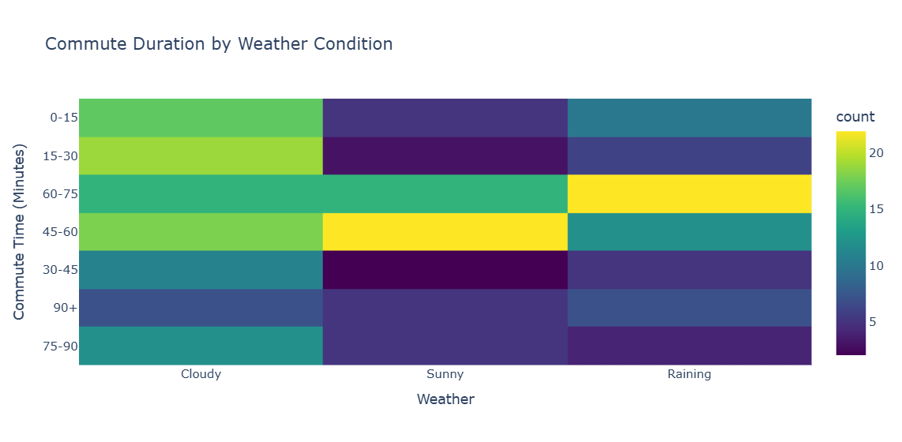
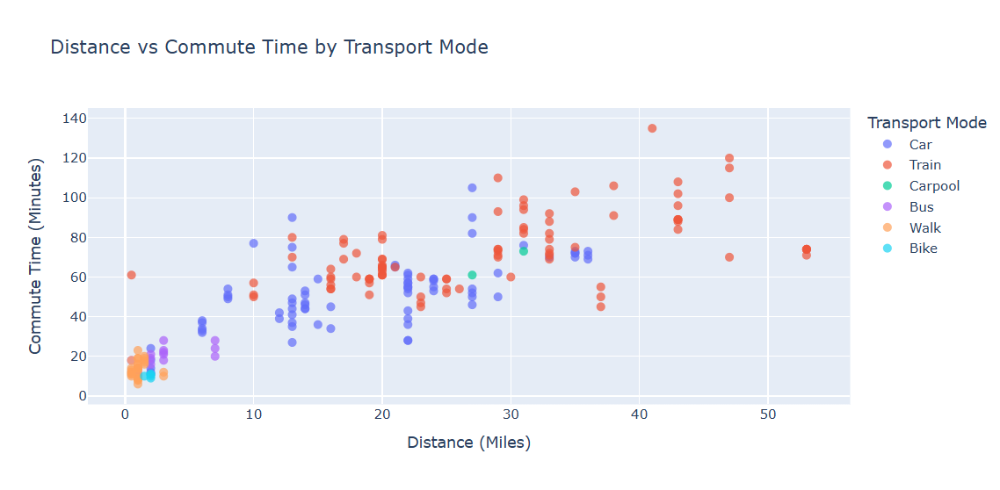
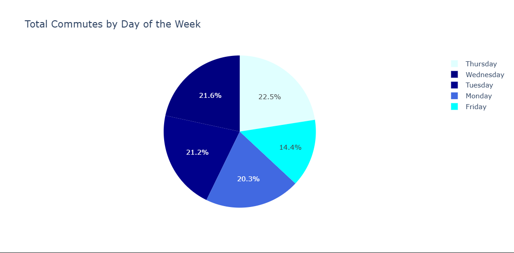

## Task 1 : Revisiting Our Data and Questions

During assignment 1, we inspected our dataset more carefully and identified several problems that would limit our analysis. We decided it may be too late to pivot during Assignment 1, so we made changes now, as part of our Assignment 2. The original Google Form collected commute duration and distance as bucketed ranges (e.g. “45-60 minutes”, “25-30 miles”) and starting location as free text. This caused the following issues:

Bucketed values blocked scatterplots and true averages. We couldn’t analyze continuous relationships
Free-text locations were inconsistent. While normally this could be fixed with data cleaning, we figured it was an issue on our side with data collection being unclear, since we had vague entries like “suburb” and “city-Chicago” rather than specific area names.

To address these problems, we rebuilt the Google Form midway through collection. The new form collects one day per submission, uses exact numeric values for duration and distance, uses a fixed dropdown for starting location, and eliminates the N/A confusion by only asking about days the respondent actually commuted. We are continuing to collect data with the new form through mid-October, and compiled it to ‘data/raw/a2_commute_data.csv’

**Guiding Questions for Assignment 2:**

For this assignment, our goal is to understand the shape and limitations of our newly cleaned dataset while building working visualizations and before building our final visualizations. We will use the following data-exploration questions to guide our work in Task 3:

1. What does the majority of people use to commute?
2. What time windows have the highest volume of commuters?
3. Are there specific days where commute times spike?
4. Which data points (weather, distance, transport mode) show the most interaction with each other?
5. How many observations did we lose or gain by switching to the new form format?

These guiding questions will help us determine which of our domain questions from Assignment 1 are actually supported by the data before we commit to our final visual designs.

## Task 2 : Preparing the data

All data cleaning code is located in the `datacleaning.py` file. This file reads in the raw google form data from `data/raw/` and writes out the cleaned dataset to `data/processed/commutes_clean.csv`. The raw files are not edited by hand, so running the script should always reproduce the same output.

**Main Transformations Done:**

- **Renamed Columns**: The long form questions were renamed to short names for us to utilize as variables (e.g. `location`, `duration_minutes`) so they are easier to work with in code and charts.
- **Dropped `timestamp`**: this column only recorded the time of form submission, not when the commute happened, so `date` is used instead.
- **Converted types**: Dates, times, and numbers were stored as text. We converted them to real date, time, and numeric types so they can be sorted, compared, and plotted on continuous axes.
- **Standardized locations.** Respondents typed the same place in different ways (e.g. "little italy", "Little Italy, Chicago", "Taylor and Carpenter"). We mapped every variant to one name using a lookup table, `data/lookups/locations.csv`, and added a `location_region` column (Chicago or Suburb) for city vs. suburb comparisons.
- **Standardized mode and weather.** Merged equivalent labels such as "Car" and "Car (alone)", and "Clear" and "Sunny", so each category is counted once.
- **Added derived columns:**
  - `respondent_id`: an anonymous ID (R1, R2, ...) for each entry
  - `is_rainy`: whether it was raining, for weather comparisons
  - `near_uic`: whether the commute started within 5 miles of campus, to separate local commuters from long-distance ones
  - `duration_bucket`: 15-minute ranges matching our Assignment 1 sketches, for grouped charts

## Task 3 : Explore the data

[view](task3.ipynb)

## Task 4 : Implement visualization alternatives

### Commute Duration by Mode of Transportation

This figure aims to answer the two following questions that we had:

- What does the majority of people use to commute?
- What time windows have the highest volume of commuters?

**Attributes used**:

- duration_minutes (quantitative)
- mode_of_transportation (categorical)

**Marks and channels**:

- Marks:
- Lines, one smooth curve per mode of transporation
- Points for modes with too few commutes to draw a curve
- Channels:
- Horizontal position for commute time in minutes
- Vertical position for how common that commute time is within each mode
- Color hue to tell modes apart

**Why did we try this approach**:
This approach was an attempt to reimplement Sketch 4 from assignment 1. In the original sketch, commute times were grouped into 15-minute buckets because the original form only collected ranges. With the new form collecting exact minutes, we replaced the buckets with a smoothed curve for each mode, so the shape of each distribution comes from the real values instead of fixed ranges. Each curve is scaled to its own mode, which keeps the refinement from our sketch: Train and Car do not dominate the chart just because they have more observations.

**What worked and What didn't**:
Some things that worked include: The staircase pattern in the sketch reflext the data accurately and shows us where peak times are for each of the different modes of transportation. Exact minutes being used also displays data that the buckets initially grouped up, allowing for the data to reveal what we didn't ntoice before. Like how car travel can be very unpredictable in comparison to train or walking.

Some things that didn't work include: Biking data only having a couple commutes, all being within the same time frame, so the curve is just a tall narrow spike in the data. Carpool also only has 2 data points, so we can't draw that many conclusions since we don't have much data. Since this is based on density, we don't know the exact counts at each minute interval since we smoothed the graph so we can make accurate comparisons.

**Whether we will keep, modify, combine, or abandon**:
It would be a good idea to modify this graph in the future. It is a strong direction in answering our domain question, but trying a version that displays counts or maybe shows the data in a way that reveals something else may benefit us.

### Weather vs. Commute Duration (Heatmap)

This figure aims to answer the following question:

Does weather affect transportation modes for people who walk or bike to UIC? (And more broadly, how does weather impact commute times?)

**Attributes used:**

weather (categorical)
duration_bucket_str (ordinal)
count of respondents (quantitative)

**Marks and channels:**

Marks: Rectangles (grid cells)
Channels:
Horizontal position for weather condition
Vertical position for commute time bucket
Color intensity (saturation) for the number of people in that weather/time combination (darker = more people)

**Why did we try this approach:**

This approach was an attempt to reimplement our Assignment 1 heatmap sketch using our new, cleaner dataset. By using color intensity as the main channel, we are able to layer three different attributes into a single view without visual clutter. This lets us instantly spot clusters, such as whether rainy commutes heavily group around a specific duration compared to sunny days.

**What worked and What didn't:**

What worked well was the immediate readability of the color gradients. It successfully surfaces patterns that a bar chart might bury in grouped clusters, showing exactly where the "bulk" of commutes happen for each weather condition. What didn't work as well is that a heatmap only shows counts, not averages. We can see that a lot of people commute for 45-60 minutes when it is cloudy, but we can't tell if the weather actually caused that duration or if those people just live far away.

**Whether we will keep, modify, combine, or abandon:**

We will keep this graph and likely combine it with an interactive filter. In Task 5, we linked this heatmap to a scatterplot. This combination is powerful because it allows us to filter the heatmap by specific weather conditions while seeing which modes of transport are driving those long commutes in the scatterplot.

### Distance vs. Commute Time by Mode (Scatterplot)

This figure aims to answer the following questions:
What is the biggest indicator that there will be longer commute times in someone's day?
Does neighborhood/distance predict transportation mode choice?

**Attributes used:**

distance_miles (quantitative)
duration_minutes (quantitative)
mode_of_transportation (categorical)
day_of_week, weather, location_clean (used for hover context)

**Marks and channels:**

Marks: Points (dots)
Channels:
Horizontal position for distance in miles
Vertical position for commute time in minutes
Color hue to distinguish the mode of transportation
Tooltips on hover to reveal the day, weather, and starting location
**Why did we try this approach:**

This was a brand new direction for us, made possible only by switching to our revised data collection form. In Assignment 1, distance and time were bucketed ranges, which blocked us from making a true scatterplot. Now that we have exact numeric values, we can visualize continuous relationships. We wanted to see if there is a direct correlation between how far someone lives and how long it takes them, and whether that relationship changes depending on how they travel.

**What worked and What didn't:**

What worked well is that it clearly shows the strong positive correlation between distance and time. It also beautifully highlights how unpredictable car travel is compared to the train. The car dots are very scattered, meaning two people driving the same distance can have vastly different commute times, whereas the train dots form a much tighter line. What didn't work as well is overplotting. Because many people live 0 to 5 miles away, the dots overlap heavily in the bottom-left corner, making it hard to see exact counts.

**Whether we will keep, modify, combine, or abandon:**

We will definitely keep this graph. For Task 5, we implemented this scatterplot side-by-side with the heatmap and added an interactive filter. It is a very strong analytical tool. If we were to modify it, we might add a slight transparency to the dots (opacity) or jitter them to solve the overplotting issue in the dense areas.

## Total Commutes by Day of the Week (Pie Chart)

This figure aims to answer the following question:
Is there a day when the commute takes longer compared to the rest of the week? (Specifically, looking at attendance volume as a proxy for campus activity).

** Attributes used:**
day_of_week (categorical)
count of respondents (quantitative)

**Marks and channels:**
Marks: Sectors (slices of a pie)
Channels:
Angle (size of the slice) for the number of commutes
Color hue to distinguish the days of the week

**Why did we try this approach:**

We wanted a simple overview visualization to understand the coverage of our dataset. Before diving into complex relationships, we needed to know if our data was evenly distributed across the week. A pie chart is an intuitive way to see the proportion of total commutes that happen on each day.

** What worked and What didn't:**

What worked well is that it immediately shows if our data collection was biased toward certain days (for example, if we accidentally collected way more data on Tuesdays). It serves as a good baseline to remind us that our sample is not perfectly even. What didn't work as well is that a pie chart is limited. It shows us how many people commute on a given day, but it tells us absolutely nothing about how long those commutes take. We cannot use this to answer if a day is "worse" for commuting, only if it is "busier" in our dataset.

**Whether we will keep, modify, combine, or abandon:**

We will likely abandon this graph for our final visualizations. While it was helpful for our own exploratory understanding (Task 3), it does not deeply answer our core domain questions about durations, weather, and modes. If we want to show day-of-week differences in the final design, a bar chart showing average commute time per day would be much more useful and expressive than a pie chart of raw counts.

## Task 5 : Interaction and multiple views

## Task 6 : Iterate and refine

## Task 7 : Current Design
